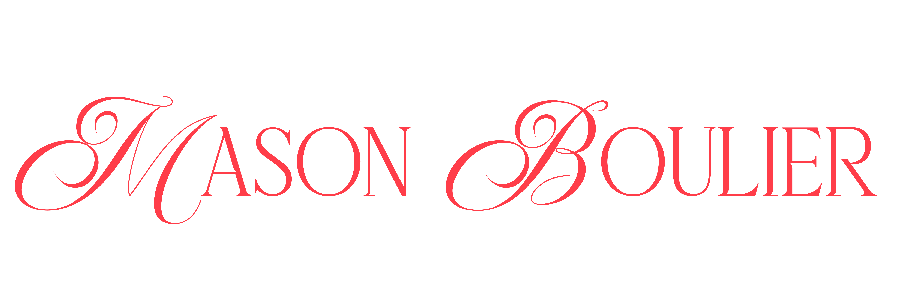

 

## about me

💻 studying **computer science** @ <mark>auburn university</mark>

✈️ incoming summer 2027 **digital & technology intern** @ <mark>delta air lines</mark>

## projects

**📔 [mindfuul](https://mindfuul.com)** - (coming soon) a guided journaling ios app that gets you off of your phone at night and in the morning.

**📆 [calent](https://calent.xyz)** - a minimal calendar + note taking web app for students

**🎛️ [onemix](https://github.com/mbouli/onemix)** - a menu bar app that gives you per-app audio control on mac. 

**🐠 [deskfish](https://github.com/mbouli/deskfish)** - lively digital fish that live in an esp32-S3 on your desk

  

